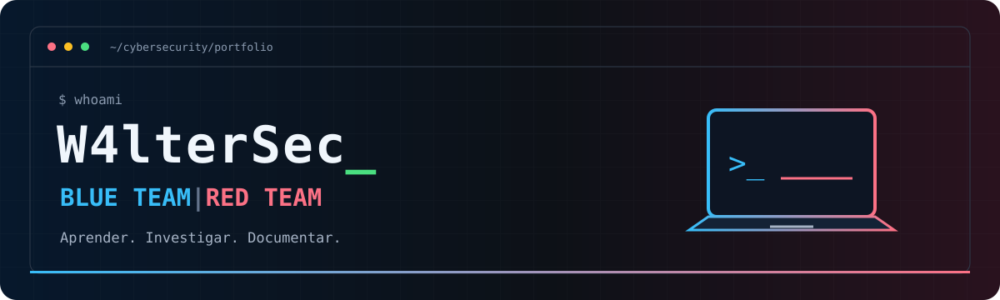

<h1 align="center">Blue Team | Red Team</h1>
<p align="center">Ciberseguridad · Laboratorios prácticos · Writeups</p>
<p align="center"><a href="https://woftwerine.github.io/cybersecurity-labs/red-team/hackmyvm/madlabs/MadLabs-Writeup.html"><strong>🌐 Ver MadLabs en formato visual</strong></a> &nbsp;·&nbsp; <a href="https://github.com/woftwerine/cybersecurity-labs">📂 Explorar mis laboratorios</a></p>

## 👋 Sobre mí

Soy **woftwerine**. Estoy construyendo mi portfolio de ciberseguridad con laboratorios prácticos y documentación de lo aprendido. Me interesan tanto la defensa como la seguridad ofensiva: entender cómo se produce un ataque ayuda a comprender cómo prevenirlo y detectarlo.

```text
woftwerine@lab:~$ cat profile.txt

ENFOQUE    Blue Team | Red Team
MÉTODO     Practicar → Investigar → Documentar
PORTFOLIO  Laboratorios y writeups
```

## 🛡️ Blue Team & ⚔️ Red Team

| 🔵 Blue Team | 🔴 Red Team |
| :--- | :--- |
| Espacio dedicado a defensa y análisis | Máquinas y laboratorios ofensivos |
| Logs, detección y respuesta a incidentes como áreas de aprendizaje | Reconocimiento, acceso inicial y escalada de privilegios |
| [Explorar Blue Team →](https://github.com/woftwerine/cybersecurity-labs/tree/main/blue-team) | [Explorar Red Team →](https://github.com/woftwerine/cybersecurity-labs/tree/main/red-team) |

## 🔬 Laboratorio destacado

### ⚡ MadLabs · HackMyVM

**Completada hasta root** · Linux · Red Team

Writeup de una cadena de explotación desde una subida de archivos hasta el control de la máquina, con notas sobre los obstáculos encontrados y las medidas de remediación.

`www-data → igor → frankenstein → root`

**Técnicas documentadas:** bypass de subida de archivos · RCE · PATH hijacking · inyección de comandos · clave SSH expuesta.

[**▶ Abrir writeup visual**](https://woftwerine.github.io/cybersecurity-labs/red-team/hackmyvm/madlabs/MadLabs-Writeup.html) · [Leer documentación](https://github.com/woftwerine/cybersecurity-labs/tree/main/red-team/hackmyvm/madlabs)

## 🧰 Herramientas presentes en mis writeups


## 📚 Mi forma de trabajar

- Practicar en entornos de laboratorio autorizados.
- Documentar los pasos, las evidencias y las lecciones aprendidas.
- Conectar cada fallo con su posible remediación.
- Mantener Red Team y Blue Team organizados por separado.

---

<p align="center"><strong>Aprender. Investigar. Documentar.</strong><br/>🔵 Blue Team &nbsp;|&nbsp; 🔴 Red Team</p>
